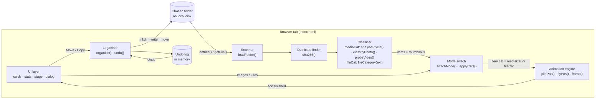
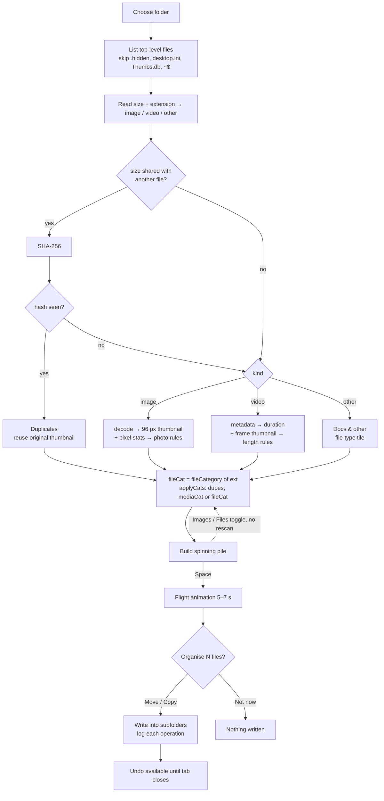
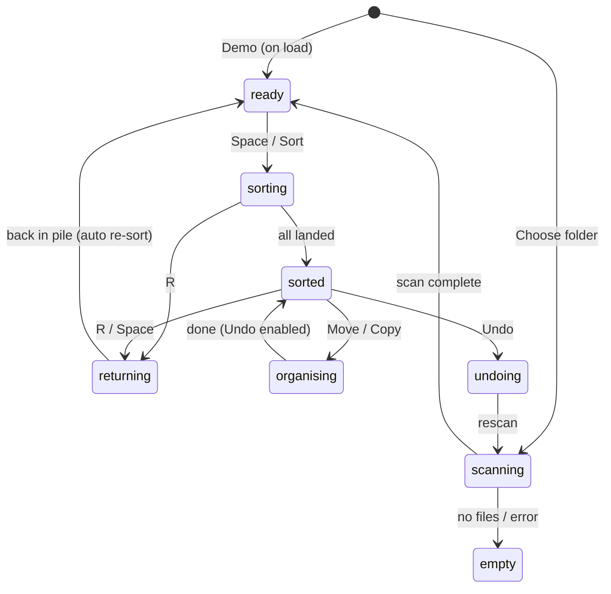

# Photo Sorter — Local Folder Organiser

A single-file web app that sorts a messy folder into tidy categories in one of two modes. **Images** mode sorts photos by colour and shape and videos by length. **Files** mode sorts every file by its extension. It shows an animation where every thumbnail flies from a spinning pile into its category card. Then it can really **move** or **copy** the files into subfolders, with **Undo**. It runs entirely in your browser: no server, no install, no paid APIs.


## Overview

Photo Sorter opens a folder you pick (`showDirectoryPicker`, read/write) and reads **only the files directly inside it**. It finds exact duplicates by SHA-256, then sorts with one of two modes. You switch modes with the **Images | Files** toggle in the toolbar:

| Mode | Sorts by | Best for |
|---|---|---|
| 🖼️ **Images** | Photo colour and shape (6 kinds), video duration (3 kinds), plus a "Docs & other" bucket | Camera rolls, `Pictures`, phone exports |
| 📄 **Files** | File extension (13 kinds: PDFs, Word & text, spreadsheets, slides, code, design, images, videos, audio, archives, installers, duplicates, everything else) | `Downloads`, `Desktop`, mixed work folders |

The folder is scanned **once**. Every file gets both an Images-mode category and a Files-mode category, so switching modes re-sorts instantly without reading the disk again.

You see the result as a tilted, slowly spinning "sunflower" pile of polaroid thumbnails. Press **Space** and each one arcs into its category card while the counters tick up. When the animation ends, the app asks **"Organise N files?"**:

- **Move** or **Copy** writes the files into subfolders.
- Files are **never overwritten**. Name clashes get ` (1)`.
- Originals are removed only by Move, and only after the copy is verified.
- Every operation can be **undone**.

A built-in **Demo** with 461 fake files loads at start-up. It has procedurally drawn photos and videos plus a realistic "Downloads" mix of documents, audio, archives and installers, so you can see the whole flow without touching the disk.

> ⚠️ Test on a **throwaway copy** of a folder first, never on your only copy of your photos.

## The categories

### 🖼️ Images mode

| Group | Category | Rule (summary) | Destination folder |
|---|---|---|---|
| Photos | **Screenshots** | "screenshot" in the name, or a lossless image with large flat areas, or a tall flat image | `Photos/Screenshots` |
| Photos | **Night & moody** | very dark, or dark and desaturated | `Photos/Night & moody` |
| Photos | **Portrait shots** | skin tones in the centre (upright framing helps) | `Photos/Portrait shots` |
| Photos | **Golden hour** | > 30 % warm amber/orange pixels | `Photos/Golden hour` |
| Photos | **Sky & sea** | > 30 % blue/cyan pixels | `Photos/Sky & sea` |
| Photos | **Everyday shots** | everything else | `Photos/Everyday shots` |
| Videos | **Quick clips** | under 10 s | `Videos/Quick clips` |
| Videos | **B-roll** | 10–60 s (or duration unreadable) | `Videos/B-roll` |
| Videos | **Long takes** | 60 s and longer | `Videos/Long takes` |
| Cleanup | **Duplicates** | byte-identical to another file (SHA-256); the original-looking one stays | `Duplicates` |
| Cleanup | **Docs & other** | anything that isn't an image or video | `Docs & other` |

### 📄 Files mode

| Group | Category | Extensions (examples) | Destination folder |
|---|---|---|---|
| Documents | **PDFs** | pdf | `Documents/PDFs` |
| Documents | **Word & text** | doc, docx, hwp, hwpx, odt, rtf, txt, md, pages, epub | `Documents/Word & text` |
| Documents | **Spreadsheets** | xls, xlsx, xlsm, csv, tsv, ods, numbers | `Documents/Spreadsheets` |
| Documents | **Presentations** | ppt, pptx, pps, key, odp | `Documents/Presentations` |
| Documents | **Code & data** | js, ts, py, ipynb, java, c, cpp, go, rs, html, css, json, xml, yaml, sql, sqlite … | `Code & data` |
| Documents | **Design** | psd, ai, fig, sketch, xd, indd, eps, svg, dwg, blend, stl … | `Design` |
| Media | **Images** | jpg, png, heic, webp, gif, avif, tif, raw, cr2, nef, arw, dng, ico … | `Images` |
| Media | **Videos** | mp4, mov, mkv, webm, avi, m4v, wmv, flv, mpg … | `Videos` |
| Media | **Audio** | mp3, wav, m4a, aac, flac, ogg, opus, aiff, mid … | `Audio` |
| Other | **Archives** | zip, rar, 7z, tar, gz, bz2, xz, iso, alz, egg … | `Archives` |
| Other | **Installers & apps** | exe, msi, dmg, pkg, apk, appx, deb, rpm, bat, jar … | `Installers & apps` |
| Other | **Duplicates** | byte-identical to another file (SHA-256); the original-looking one stays | `Duplicates` |
| Other | **Everything else** | unknown or missing extension | `Other` |

## Features

- 🔀 **Two modes, one scan:** the **Images | Files** toggle (keys `1` / `2`) switches between colour/length sorting and extension sorting. Cards, stats labels, destination folders and the Organise dialog all follow the mode. Your choice is remembered in `localStorage`.
- 🗂️ **Real folder sorting:** File System Access API with read/write access. Only top-level files are used, so subfolders (including the app's own output) are never touched.
- 🧬 **Exact duplicate detection:** files are grouped by size first, and only same-size files are SHA-256 hashed (Web Crypto). In each identical group, the file that looks most like the original stays where it is. A clean name wins over `(1)`, ` 2`, `copy`, `복사본` and similar; after that, the oldest file, then the shortest name. Every other copy goes to Duplicates.
- 🧾 **Extension classifier (Files mode):** about 200 extensions mapped to 11 type categories, plus Duplicates and Everything else. No decoding is needed to classify.
- 🎨 **Colour-based photo classifier (Images mode):** each image is downscaled to 40 px wide. Luma, saturation, warm/blue share, flatness, centre skin share and aspect ratio feed six ordered rules.
- 🎞️ **Video duration buckets (Images mode):** hidden `<video preload="metadata">` reads the duration and grabs a frame for the thumbnail.
- 🌻 **Sunflower pile animation:** golden-angle spiral, slow spin, tilt, depth scaling and polaroid frames. All motion uses `requestAnimationFrame` and CSS transforms.
- 🏹 **Arc flights:** Bézier arcs with a "slow, then rush" launch schedule. The full sort takes 5–7 s. Card thumbnail grids fill up and counters tick live.
- 🔁 **Replay:** every thumbnail flies back to the pile and the sort runs again.
- 📦 **Move or Copy:** creates `Photos/…`, `Videos/…`, `Duplicates`, `Docs & other` only as needed and reuses existing folders.
- 🛡️ **Never overwrite, never lose data:** unique names (`name (1).ext`). Move uses native `handle.move()` or a verified copy followed by removing the original.
- ↩️ **Undo:** reverses every move or copy, removes only the empty folders the app created, then rescans.
- 🧪 **Demo mode:** 461 seeded fake files. They include procedurally painted photos (night skylines, sunsets, seascapes, portraits, screenshots) and videos, plus documents, audio, archives, installers and duplicates, so both modes have something to show. It never touches disk.
- 📊 **Live stats:** total files, photos and videos (Images mode) or documents and media (Files mode), duplicates, and space taken by duplicates.
- ⌨️ **Keyboard:** `1` / `2` switch mode, `Space` sorts, `R` replays, `Esc` closes the dialog.
- 🎨 **Anthropic-style theme:** cream, clay and ink palette, DM Sans with Source Serif 4, a responsive layout and reduced-motion support.
- 🔒 **100 % local:** no uploads, no analytics, no API keys.

## Tech Stack

| Layer | Technology |
|---|---|
| App | One `index.html`: vanilla JavaScript (ES2022), no framework, no build step |
| Styling | Plain CSS with custom-property tokens, CSS Grid, DM Sans + Source Serif 4 (Google Fonts, optional) |
| File access | File System Access API (`showDirectoryPicker`, `getDirectoryHandle`, `createWritable`, `FileSystemHandle.move`, `removeEntry`) |
| Hashing | Web Crypto `crypto.subtle.digest('SHA-256')` |
| Image decoding | `createImageBitmap` (resize on decode), falling back to `.decode()` |
| Pixel analysis | Canvas 2D `getImageData` on a 40 px-wide copy |
| Video probing | `HTMLVideoElement` metadata + frame capture to canvas |
| Animation | `requestAnimationFrame` loop + CSS `transform` on DOM sprites (no canvas, no libraries) |
| Randomness | Seeded mulberry32 PRNG (demo set and pile order are reproducible) |

## System Architecture



### End-to-end process



| # | Step | Function | Notes |
|---|---|---|---|
| 1 | Pick folder | `chooseFolder()` | `showDirectoryPicker({mode:'readwrite'})`. Cancelling is silent. |
| 2 | List files | `loadFolder()` | Files only, natural sort (`IMG_2` before `IMG_10`). Size and modified time are read per file. A file that can't be opened (in use, cloud-only placeholder) is kept as *unreadable* instead of failing the scan. |
| 3 | Duplicates | `sha256()`, `originalFirst()` | Only same-size groups, 2 hashes in parallel. Files over 768 MB hash the first 16 MB + last 16 MB + size. Identical files are grouped, and `originalFirst()` picks which one stays. A hashing error affects only that file. |
| 4 | Analyse | `analyseImage()`, `analyseVideo()` | 4 in parallel via `pool()`. Progress shows on the stage. |
| 4b | Pick mode categories | `applyCats()` | `item.cat` = `dupes` if duplicate, else `mediaCat` (Images) or `fileCat` (Files). |
| 5 | Build pile | `buildPile()` | One sprite per file, up to 600 (sampled proportionally beyond that). |
| 6 | Sort | `startSort()` → `frame()` → `land()` | Counters reach the exact file totals even when sampled. |
| 7 | Confirm | `openModal()` | Folder mode only. The dialog lists every destination with its count. |
| 8 | Organise | `organise('move' \| 'copy')` | Sequential, one `try/catch` per file. Failures are reported, not fatal. |
| 9 | Undo | `undo()` | Reverse order, then removes only empty app-created folders and rescans. |

**Mode switching** (`switchMode`) is allowed whenever nothing is running (ready, sorted or empty). It swaps the active category set (`CATS`), rebuilds the cards, recomputes the stats and rebuilds the pile. It doesn't touch the disk.

Every async scan step checks a `scanToken`, so starting a new scan or the Demo quietly cancels an older one.

## Classification Logic

Both modes are **rule-based, not AI**.

### Duplicates (both modes)

```
group files by size                      // different size → can't be identical
hash every file in a same-size group     // SHA-256, Web Crypto
group by hash → for each group of 2+:
    sort with originalFirst():
        1. name doesn't look like a copy   ("IMG_1.jpg" beats "IMG_1 2.jpg", "report (1).pdf", "a - Copy.txt", "사진 복사본.jpg")
        2. older last-modified time
        3. shorter name
        4. natural name order
    first  → stays in its normal category
    others → Duplicates
```

Empty (0-byte) files are never treated as duplicates.

### Files mode (`fileCategory`)

The lower-cased extension (text after the last `.`) is looked up in `FILE_EXT_CAT`, a `Map` built from the `ext` lists in `FILE_CATS`. Anything not found, or a file with no extension, goes to **Everything else**. Duplicates are found first by SHA-256 and override the extension category. Images and videos are still decoded once, but only to draw their real thumbnails. Every other file gets a generated tile coloured like its category.

### Images mode

The Images-mode classifier is fast and predictable, but it can't recognise content such as "food" or "pets".

### Pixel metrics (`analysePixels`)

| Metric | Computation | Signals |
|---|---|---|
| `lum` | mean Rec.709 luma `0.2126R + 0.7152G + 0.0722B` | dark vs bright |
| `sat` | mean HSV saturation | muted vs colourful |
| `warm` | share of pixels: hue 12–55°, sat > 0.28, value > 0.40 | sunsets, amber light |
| `blue` | share of pixels: hue 180–250°, sat > 0.15, value > 0.30 | sky, water |
| `flat` | share of horizontal neighbours with ΣRGB difference < 8 | flat UI (screenshots) |
| `skin` | skin-rule pixels in the centre box (x 22–78 %, y 12–72 %); rule: `R>95, G>40, B>20, R>G, R>B, R−G>15, max−min>15, hue≤45°` | a person in frame |
| `ratio` | height ÷ width | upright photos, tall phone captures |

### Ordered rules (`classifyPhoto`): the first match wins

| Order | Category | Condition |
|---|---|---|
| 1 | Screenshots | name matches `screenshot / screen shot / 스크린샷 / screencap / capture / 캡처` · **or** png/webp/gif/bmp and `flat > 0.42` · **or** `ratio ≥ 1.9`, `flat > 0.5`, `lum > 0.3` |
| 2 | Night & moody | `lum < 0.24` · **or** `lum < 0.33` and `sat < 0.25` |
| 3 | Portrait shots | `skin > 0.22` and `ratio > 1.1` · **or** `skin > 0.38` |
| 4 | Golden hour | `warm > 0.30` |
| 5 | Sky & sea | `blue > 0.30` |
| 6 | Everyday shots | otherwise |

The order matters:

- **Screenshots first:** flat UI can be dark or blue.
- **Night next:** hue is unreliable in dark images.
- **Portrait before Golden:** skin tones also count as "warm".

Undecodable images such as HEIC fall back to Screenshots when the name contains "screen", and to Everyday otherwise.

### Videos (`probeVideo`)

The app reads `duration` and seeks to `min(1 s, duration/3)` for the thumbnail, with an 8 s timeout.

| Category | Rule |
|---|---|
| Quick clips | under 10 s |
| B-roll | 10–60 s, or duration unreadable |
| Long takes | 60 s or longer, or `Infinity` |

### Known misclassifications

- Tungsten-lit indoor shots → Golden hour
- People against blue walls or sea → Sky & sea
- Wood, sand or brown food in the centre → Portrait
- JPEG screenshots without "screenshot" in the name → Everyday

For content-aware categories, replace `classifyPhoto()` with an in-browser vision model such as CLIP via Transformers.js. The rest of the pipeline doesn't change.

## Animation Engine

- **Sprites:** absolutely positioned `.sprite` polaroids inside a fixed, full-viewport overlay (`pointer-events: none`), so they can fly from the stage to any card.
- **Pile (`pilePos`):** a Vogel sunflower spiral. Sprite size is `Rmax·2/√N · 1.15`, clamped to 14–52 px under 120 files and 14–36 px above. The radius shrinks for small folders (`size·√N·0.62`), so 30 files form a compact heap instead of a sparse ring.
  `r = R·√k`, `angle = i·137.5° + θ`, `y` squashed by `TILT = 0.86`, with a slight dome toward the centre.
  `θ` grows by `SPIN` each frame (≈ one turn per 57 s). The centre and front sprites sit on top. Sprites pop in with `easeOutBack` and bob gently.
- **Launch schedule (`startSort`):** sprite *k* of *N* launches at `150 ms + L·(k/N)^0.55`, with `L = clamp(3800 + 3N, 4200, 5800) ms`. Early launches are sparse and later ones come in a rush. Flight time shrinks from 1150 ms to 620 ms.
- **Flight (`flyPos`):** a quadratic Bézier whose control point is offset sideways and lifted by 30 % of the distance. It uses `easeInOutCubic`, adds a ±20° spin and +0.35 scale at the apex, and lands at 0.46 scale.
- **Landing (`land`):** the sprite hides and a real thumbnail is appended to the card's grid slot (`slotPos`). The counter ticks and the card border flashes in its colour.
- **Replay:** sprites fly back from wherever they are to their live pile positions. Rotation is wrapped to ±180°.
- **Performance:** layout is measured only when dirty (on resize, scroll or rebuild). The frame loop only writes transforms. `prefers-reduced-motion` disables spin and bob.

### State machine



## Getting Started

```text
1. Open index.html in desktop Chrome or Edge   (double-click, or drag into the browser)
2. Watch the Demo: press Space, then R to replay; press 2 for Files mode, 1 for Images
3. Pick a mode (Images | Files) → "Choose folder" → pick a TEST folder → allow edit access
4. Wait for the scan → press Space
5. "Organise N files?" → Move / Copy / Not now
6. Changed your mind? → Undo (status bar or toast)
```

| Key / Button | Action |
|---|---|
| `1` / **Images** | Images mode (colour & length) |
| `2` / **Files** | Files mode (extension) |
| `Space` / **Sort** | Sort the pile into the cards |
| `R` / **Replay** | Fly everything back and sort again |
| **Choose folder** | Scan a real folder |
| **Demo** | Reload the fake photo set |
| **Organise files…** | Reopen the Move/Copy dialog |
| **Undo** | Revert the last Move/Copy |
| `Esc` | Close the dialog |

> **iPhone:** export photos as JPEG from the Photos app first. Chrome can't decode HEIC. Never select the Photos library package itself.

### Configuration

There is no config file. Tunables are constants at the top of the `<script>`:

| Constant | Default | Effect |
|---|---|---|
| `MAX_SPRITES` | 600 | Most thumbnails animated at once |
| `HASH_FULL_MAX` | 768 MB | Above this, partial hashing is used |
| `SPIN` | 0.00011 rad/ms | Pile rotation speed |
| `TILT` | 0.86 | Pile perspective squash |
| `L` / exponent `0.55` in `startSort` | 4.2–5.8 s | Total sort length / "slow then rush" curve |
| thresholds in `classifyPhoto` | see above | Photo category boundaries |
| `10 / 60 s` in `analyseVideo` | — | Video category boundaries |
| `pool(…, 4)` / `pool(…, 2)` | 4 / 2 | Analysis / hashing parallelism |

**Adding a category:**
- *Images mode:* add an entry to `MEDIA_CATS` (`group: photos | videos | cleanup`, label, colour, folder) and return its `id` from `classifyPhoto()` / `analyseVideo()`.
- *Files mode:* add an entry to `FILE_CATS` (`group: docs | media | other`) with an `ext: [...]` list. To move an extension to another category, just move it between `ext` lists.

Either way, the card, counter, flight target, dialog row and destination folder all follow automatically. Column headings and stat labels live in `MODES`.

## Quality & Safety

- **Never overwrite:** `uniqueName()` probes the destination and appends ` (1)`, ` (2)`, … until the name is free.
- **No data loss on Move:** native `FileSystemHandle.move()` is used when available. Otherwise `moveHandle()` copies, **verifies the byte size**, and only then removes the original entry.
- **Copy never removes anything.** Undo of a copy deletes only the app's own copy, and only if the original still exists with the same size.
- **Scoped access:** only top-level files of the chosen folder are read or written. Nothing happens on disk until you press Move or Copy. The Demo never writes.
- **Precise Undo:** removes only folders this run **created**, deepest first, non-recursively. Any non-empty or pre-existing folder is kept.
- **Fault isolation:** reading, hashing, decoding and organising each run per file. One locked, cloud-only or corrupt file is skipped and reported (status bar and console). It never aborts the scan or the Move/Copy run. The video probe always resolves, even when a file can't be opened.
- **Stale-scan protection:** a `scanToken` cancels superseded scans.
- **Privacy:** there are no `fetch` calls, analytics or keys. The only network request is Google Fonts, which is optional; remove the `<link>` tags for a fully offline file.
- **Verified:**
  - The script passes `node --check`.
  - The Demo (461 files) was sorted end-to-end in headless Chrome in both modes, and every card counter matched its expected total.
  - A real directory handle (Chrome OPFS) was tested with 35 files. They included real JPEG/PNG/WebP images, ffmpeg-generated MP4/MOV videos, documents, code, archives, installers, audio, a broken HEIC, an extension-less file, a Korean filename, an upper-case extension, empty files, duplicates, a subfolder and a pre-existing destination file.
  - **Move**, **Copy** and **Move without native `move()`** all put every file in the right folder. A name clash became `UPPER (1).PDF` and the existing file was untouched. **Undo** restored the exact original file list each time.
  - The only parts not exercised automatically are the native folder picker and permission prompt, which need a human click.

## Project Structure

```
image_sorter/
├── index.html      # the whole app
│   ├── <style>     # design tokens (cream / clay / ink), layout, cards, sprites, dialog, toast
│   ├── markup      # title bar · header + Images|Files toggle + toolbar · stats · board (left cards | stage | right cards)
│   │               # · status bar · sprite overlay · Organise dialog · toast
│   └── <script>
│       ├── Categories        MEDIA_CATS, FILE_CATS, FILE_EXT_CAT, MODES, CATS/CAT (active set),
│       │                     IMG_EXT, VID_EXT, SKIP, tuning constants
│       ├── Utilities         clamp/lerp/wrap, easings, rng (mulberry32), shuffle, pool, toast, countTo
│       ├── Cards             buildCards (columns + headings from MODES), resetCards, cardCount
│       ├── Stats & UI        setStats, setPhase, refreshUI, updateStageLabel, setCenter
│       ├── Sort mode         applyCats, useMode, switchMode
│       ├── Analysis          makeThumb, analysePixels, classifyPhoto, decodeImage,
│       │                     analyseImage, probeVideo, analyseVideo, sha256
│       ├── Generated tiles   tileThumb, extTile, DEMO_PAINT, demoThumb, buildDemoItems
│       ├── Animation         measureLayout, pickSprites, buildPile, pilePos, slotPos,
│       │                     flyPos, apply, frame, startSort, land, onSortDone, replay
│       ├── Loading           runDemo, chooseFolder, loadFolder
│       ├── Organise & undo   fileExists, uniqueName, ensureDir, getDir, copyInto,
│       │                     moveHandle, ensurePermission, openModal, organise, undo
│       └── Wiring            restore saved mode, buttons, keys 1/2/Space/R, runDemo(), rAF loop
└── README.md
```

### Core data shapes

```js
item = {                       // one per file
  name, ext, size,
  kind: 'image' | 'video' | 'other',
  mediaCat: 'screens' | 'night' | 'golden' | 'sky' | 'portrait' | 'everyday'
          | 'quick' | 'broll' | 'long' | 'docs',                   // Images mode
  fileCat:  'pdf' | 'word' | 'sheet' | 'slides' | 'code' | 'design'
          | 'img' | 'vid' | 'audio' | 'archive' | 'app' | 'misc',  // Files mode
  dupe?:    true,                                                  // overrides both
  cat,                         // active one: 'dupes' | mediaCat | fileCat
  thumb,                       // 96×96 data URL
  handle?, hash?, dupeOf?, dur?
}

sprite = {                     // one per animated thumbnail
  el, it, cat, i, base,
  state: 'pile' | 'queued' | 'fly' | 'done' | 'return',
  t0, dur, side, slot, from, toFn, cur   // pose = {x, y, r, s, z}
}

undoLog = {
  mode: 'move' | 'copy',
  entries:     [{ mode, orig, path: ['Photos','Golden hour'], name }],
  createdDirs: [['Photos'], ['Photos','Golden hour']]
}
```

## Limitations

- Desktop **Chrome / Edge only** for real folders, because the File System Access API is required. The Demo works in any modern browser.
- Images mode is a **heuristic**, based on colour and shape rather than content.
- Files mode trusts the **extension**. A renamed or extension-less file is sorted by its name, not its real content type.
- **HEIC** and some **MOV/HEVC** files can't be decoded by Chrome. They are still sorted, using fallback rules.
- **Exact duplicates only.** Near-duplicates (bursts, edits, resizes) aren't detected.
- **Top-level files only.** Nested folders aren't scanned.
- **Undo lasts only for the tab session.** It is lost on reload or close.
- Large folders take a while to scan, because every image is decoded once (about 5 KB of memory per thumbnail).

## License

woogi License — Copyright (c) 2026 woogi. All rights reserved.

Permission is granted to woogi to use, copy, and modify this software for personal, non‑commercial purposes. Redistribution, sublicensing, or commercial use by any other party is not permitted without the express written consent of the copyright holder.

THE SOFTWARE IS PROVIDED "AS IS", WITHOUT WARRANTY OF ANY KIND. Photo Sorter moves and copies files on your own computer at your own risk; always keep a backup and try it on a copy of your folder first. The author is not liable for any loss of, or damage to, files or data. Photo Sorter is not affiliated with Anthropic, Google, Apple, or Microsoft. The colour palette and fonts are used for personal styling only; all trademarks are the property of their respective owners. Your photos and files remain your own and never leave your computer.
